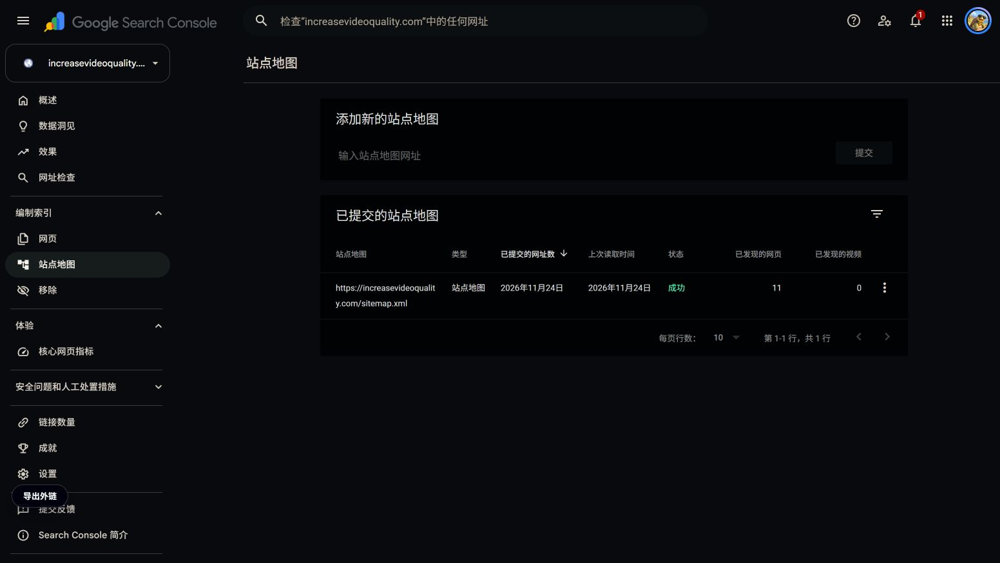
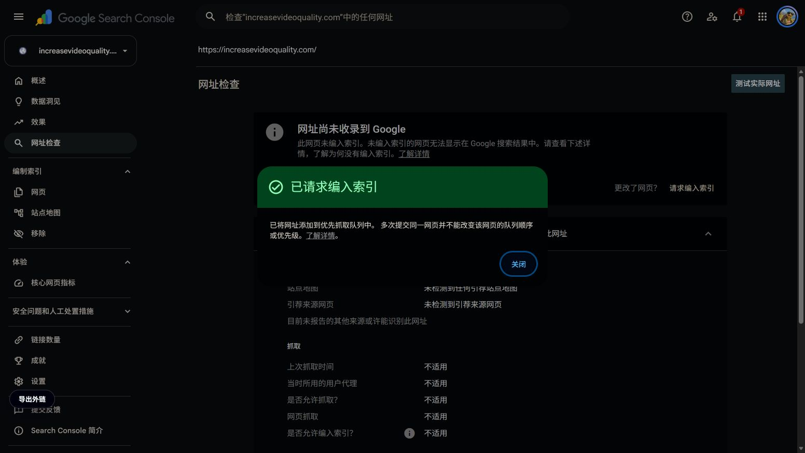
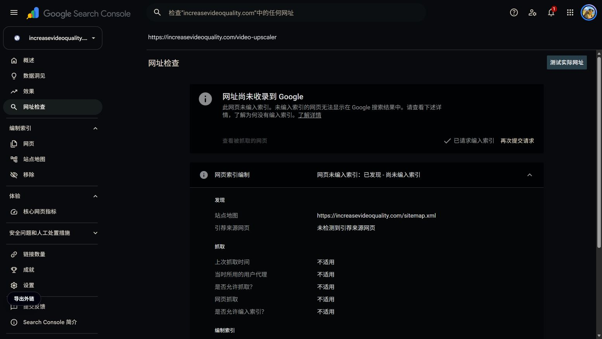

# 主域名切换日索引与跳转检查

日期：2026-11-24（Asia/Shanghai）。正式域名： https://increasevideoquality.com 。

## canonical、Open Graph 与站点链接

使用 curl GET 检查 sitemap 内全部 11 个公开页面：均为 HTTP 200，每页只有一个 canonical，canonical 与 og:url 都自指正式 HTTPS 域名。公开 HTML 中没有 workers.dev。价格、正文与页面 URL 未修改。

| 新增页面 | HTTP | canonical 与 og:url |
| --- | --- | --- |
| /video-upscaler | 200 | https://increasevideoquality.com/video-upscaler |
| /fix-blurry-video | 200 | https://increasevideoquality.com/fix-blurry-video |
| /restore-old-video | 200 | https://increasevideoquality.com/restore-old-video |
| /upscale-ai-clips-for-4k-editing | 200 | https://increasevideoquality.com/upscale-ai-clips-for-4k-editing |
| /fix-compressed-video | 200 | https://increasevideoquality.com/fix-compressed-video |

五个页面的带尾斜杠访问也已验证，最终 HTTP 200，canonical 沿用现有无尾斜杠 URL，不改站内地址规范。

## robots、sitemap 与跳转

- 首页 HTTP 200。
- `/robots.txt` HTTP 200，`Sitemap: https://increasevideoquality.com/sitemap.xml`。
- `/sitemap.xml` HTTP 200，11 条 URL 均属于正式域名，含上表五页。
- 首页和五个新增页面的 HTTP 地址均以 301 转到同路径 HTTPS 地址。
- workers.dev 保留为可访问的预览环境，返回 200 + noindex，按本任务要求不改成强制跳转。

## 预览环境 noindex

- `src/middleware.ts` 按实际请求 URL 的 hostname 判断 `.workers.dev`，页面与 sitemap 返回 `X-Robots-Tag: noindex, follow`，覆盖首次和后续访问。
- `public/_headers` 只匹配 workers.dev，为直接由 Cloudflare 提供的静态资源补同一响应头。
- 主站不带 noindex。保留爬取能力，让搜索引擎能看到 noindex 指令。
- 线上验证覆盖预览环境全部 11 页、sitemap、robots、favicon，均通过。
- 服务器判断和部署规则中保留 workers.dev 字符串是必要的主机匹配逻辑，不会出现在页面 HTML 正文或 SEO URL 中。
- 实现依据：[Cloudflare static asset headers](https://developers.cloudflare.com/workers/static-assets/headers/)。

## Google Search Console

- 资源：`sc-domain:increasevideoquality.com`，已通过根域 Google TXT 验证。
- 已提交 `https://increasevideoquality.com/sitemap.xml`。GSC 状态“成功”，已发现 11 个网页。
- 首页 `https://increasevideoquality.com/`：GSC 已显示“已请求编入索引”，加入优先抓取队列。首次提交遇到 Google 暂时错误，重试成功。
- `https://increasevideoquality.com/video-upscaler`：GSC 已显示“已请求编入索引”，加入优先抓取队列。提交现有 canonical 的无尾斜杠地址，带尾斜杠访问已在 curl 中核对。
- 提交后两页仍显示尚未收录。这是本次观察到的状态，不能把“已请求”写成“已收录”。
- 保留 DNS 验证 TXT，不要删除。此操作没有改变网站 A 记录、Worker 路由或 DNSSEC。
- GSC 提交成功并不代表页面已经进入搜索结果；Google 抓取和索引仍会异步处理。

## 验证与发布

- 相关测试 10/10，`pnpm lint`、`pnpm build`、`pnpm build:vinext` 均成功。
- 应用 Worker 版本：`b09675ec-df45-4f5c-95ba-c1898d5892b6`。
- 新增可复跑检查：`node scripts/check-domain-indexing.mjs`，内部使用 curl GET，失败以非 0 退出。
- 完整输出：`domain-indexing-check.txt`，结果 `Domain indexing check: ALL PASSED`。
- SSR 输出：`domain-indexing-ssr.txt`，结果 `SSR check: 11/11 passed.`。
- GSC 截图：`gsc-dns-verification.jpg`、`gsc-ownership-verified.jpg`、`gsc-sitemap-success.jpg`。
- 收录请求截图：`gsc-home-index-requested.jpg`、`gsc-upscaler-index-requested.jpg`。Edge 任务标签页已全部关闭，保留用户原有标签页。

只进行了公开页面抓取与索引配置，没有提交视频处理、真实支付或读取用户私有任务。
