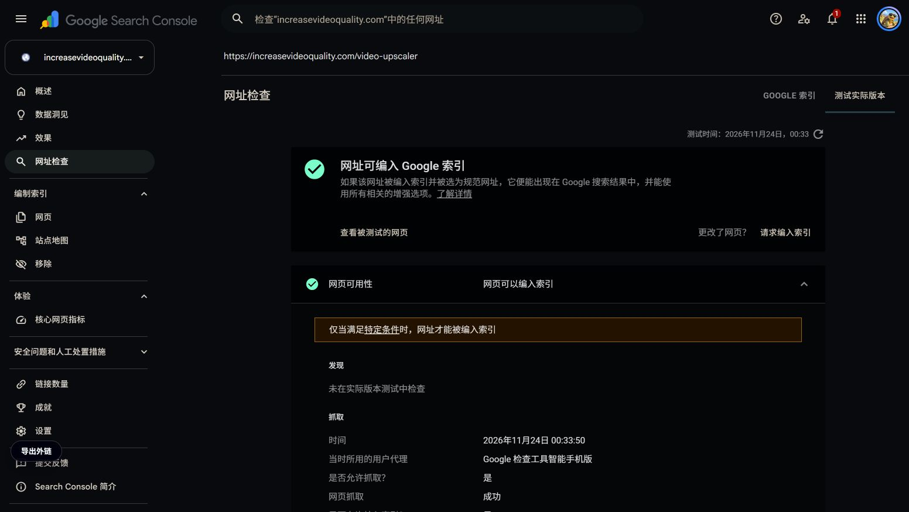
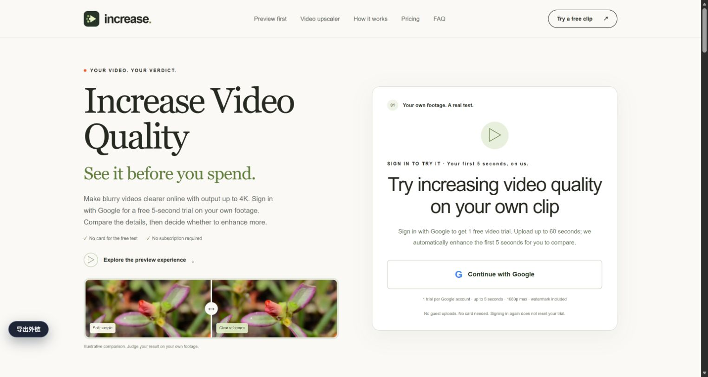

# 首页内链与 GSC 抓取检查

日期：2026-11-24（Asia/Shanghai）。

## 导航与内容内链

- 首页、Pricing 与 Video Upscaler 页头补充 `Video upscaler`；使用 GuidePage 的内页原本已有该入口，继续保留。
- 全站 SiteFooter 加入相同入口。
- 首页示例介绍加入 `video upscaler guide`。全部使用现有 canonical 路径 `/video-upscaler`，不改变 URL 规范。
- 原四张场景卡及 CTA 保留；在示例标题与介绍中增加第二处上下文链接，不复制场景卡。
- 没有修改 CSS、H1/H2/H3 标题文本、价格、上传或增强流程。

## 原始 HTML 验收

使用 curl GET 获取线上首页后，去除 script/style，再统计真实 `<a href>`。不把 RSC 或 JSON 中的文本计入链接数量。

| 页面 | 首页链接数 | 不同锚文本 |
| --- | --- | --- |
| /video-upscaler | 3 | Video upscaler（页头、页脚）；video upscaler guide（正文） |
| /fix-blurry-video | 2 | Fix blurry video；Fix blurry phone footage before posting to TikTok |
| /restore-old-video | 2 | Restore old video；bring an old recording back into focus |
| /upscale-ai-clips-for-4k-editing | 2 | Upscale AI clips for 4K editing；prepare AI footage for a 4K timeline |
| /fix-compressed-video | 2 | Fix compressed video；Clean up the softness left by video compression |

四张 `.story` 卡数量仍为 4。页头、页脚分别包含 Video upscaler 入口。完整输出见 `home-links-check.txt`。

## GSC 抓取检查

- 正式索引报告：检查时没有上次抓取时间，显示尚未编入索引。上一任务已成功提交收录请求，Google 的正式抓取及报告刷新仍由 Google 安排。
- 本次执行 GSC“测试实际网址”，得到真实 Google 检查工具抓取记录：
  - 地址：`https://increasevideoquality.com/video-upscaler`
  - 抓取时间：2026年11月24日 00:33:50（GSC 页面显示）
  - 用户代理：Google 检查工具智能手机版
  - 是否允许抓取：是
  - 网页抓取：成功
  - 是否允许编入索引：是
  - 用户声明 canonical：`https://increasevideoquality.com/video-upscaler`
- 实时检查不是正式 Googlebot 索引抓取；不能据此宣称已收录，或宣称正式索引报告已出现抓取时间。本次满足实际 Google 抓取可访问性检查，正式报告记录仍待更新。
- 证据：`home-links-gsc-live-crawl.txt`、`home-links-gsc-live-crawl.jpg`。

## 发布与验证

- `pnpm lint`、`pnpm build`、`pnpm build:vinext` 成功。
- 线上 SSR 11/11，通过记录 `home-links-ssr.txt`。
- Worker 版本：`c519bc78-9c54-4b23-b6fc-28e6acad8985`。
- Edge 桌面导航与首页链接数量正确；390px 视口下新增页脚链接未超出页面。检查后恢复视口并关闭任务标签页。

